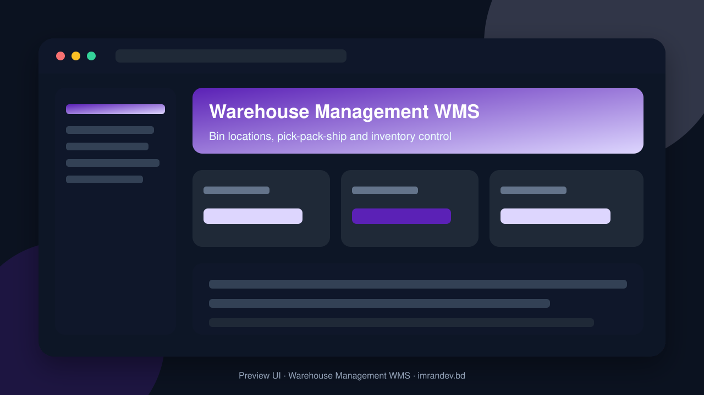
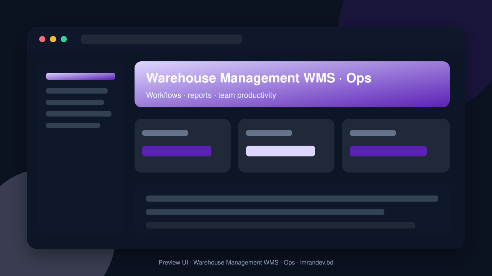

<p align="center">
  
</p>

# Warehouse Management WMS

<p align="center"><strong>Bin locations, pick-pack-ship and inventory control</strong></p>

<p align="center">
  <a href="https://github.com/imranbru99/warehouse-management-wms-pick-pack-ship"></a>
  
  
</p>

---

## Overview

**Warehouse Management WMS** — Bin locations, pick-pack-ship and inventory control.

This README documents the **real application features** so GitHub and Google visitors can understand what the product does.

## Product screenshots

| Dashboard | Operations |
| :---: | :---: |
|  |  |

## Application features

### Warehouse management (WMS)

- Warehouse, zone, bin and location masters
- Inbound receiving and putaway
- Inventory accuracy and cycle counts
- Wave / order picking strategies
- Pack station and shipping label flows
- Pick-pack-ship outbound execution
- Transfers, adjustments and holds
- Worker productivity and backlog dashboards

### Admin screens (Filament resources)

- Asn management
- Customer management
- Location management
- Product management
- Purchase Order management
- Putaway Task management
- Qc Inspection management
- Receipt management
- Rma Request management
- Sales Order management
- Shipment management
- Stock Adjustment management
- Stock Balance management
- Stock Ledger Entry management
- Supplier management
- Warehouse management
- Wave management

### Domain data models

- Allocation
- Asn
- Asn Line
- Carton
- Customer
- Load
- Location
- Lpn
- Module Definition
- Pick Task
- Product
- Product Barcode
- Purchase Order
- Purchase Order Line
- Putaway Task
- Qc Inspection
- Receipt
- Receipt Line
- Return Receipt
- Rma Line
- Rma Request
- Sales Order
- Sales Order Line
- Shipment
- Shipment Package
- Stock Adjustment
- Stock Adjustment Line
- Stock Balance
- Stock Ledger Entry
- Supplier
- Tenant
- Tenant Module
- Tracking Event
- Uom
- Warehouse
- Warehouse Task
- Wave
- Zone

## Tech stack

- PHP 8.2+ / Laravel
- Filament admin (where enabled)
- Migrations, seeders, queues
- Vite asset pipeline
- MySQL / SQLite ready

## Quick start

```bash
git clone https://github.com/imranbru99/warehouse-management-wms-pick-pack-ship.git
cd warehouse-management-wms-pick-pack-ship
composer install
cp .env.example .env
php artisan key:generate
php artisan migrate --seed
npm install && npm run build
php artisan serve
```

## Author

**Imran Ahmed** · https://imrandev.bd · me@imrandev.bd  
GitHub: https://github.com/imranbru99/warehouse-management-wms-pick-pack-ship

---
## 🤝 Let's Connect & Collaborate

I am open to **Senior Remote Full-Stack Roles**, AI Platform Architecture Contracts, and Enterprise Technical Advisory.

| Channel | Link |
| :--- | :--- |
| Portfolio | https://imrandev.bd |
| GitHub | https://github.com/imranbru99 |
| LinkedIn | https://linkedin.com/in/imranbru99 |
| Email | me@imrandev.bd |
| WhatsApp | https://wa.me/8801576918420 |
| Packagist | https://packagist.org/packages/imrandevbd/ |

